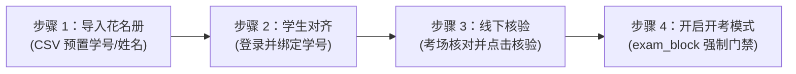

# SCIP-OJ 教师手册：考试花名册核验与开考模式操作指南

## 1. 为什么必须进行「线下核验」？
在高校计算机与工业工程课程的正式上机考试或权威考核中，单纯依靠学生自报学号存在严重代考隐患：
- **自报学号不可信**：任意 GitHub 账号登录后，均可在个人资料中填写他人的学号；
- **防代考硬防线**：SCIP-OJ 引入了数据库级强制拦截约束——在开考模式（`exam_block`）下，系统在入库前强制检查 `public.is_verified_course_student(course_id, user_id)`。**未经过教师线下核验确认的账号，即使学号完全匹配，也绝不允许入库交卷**（直接拦截并返回 `IDENTITY_VERIFICATION_REQUIRED`）。

通过四步闭环操作，任课教师可在 10~15 分钟内完成全班学生的考前身份锁定。

---

## 2. 标准四步操作流程



### 步骤一：预置学生花名册 (CSV 导入)
1. 登录教师或助教账号，进入 **教师控制台** (`/teacher.html`)；
2. 在顶部下拉框中确认并选择当前授课班级；
3. 点击 **「📋 花名册与导入」** 选项卡；
4. 准备学生名单 CSV，格式支持以下列（首行表头自动识别）：
   ```csv
   学号,姓名,可选GitHub用户名
   20260001,张三,zhangsan-dev
   20260002,李四,lisi2026
   20260003,王五,
   ```
   > [!TIP]
   > - 若学生尚未注册或未确定 GitHub 登录名，第三列可直接留空；
   > - 支持逗号 `,`、分号 `;` 或制表符 Tab 分隔；
   > - 系统已自动做 UTF-8 BOM 处理与防 CSV 公式注入过滤。
5. 粘贴文本到输入框，或点击 **「从文件导入 (.csv)」** 上传，点击 **「确认导入花名册」**。

---

### 步骤二：学生登录并完成学号自动匹配
1. 教师向班级出示 **学生选课邀请码**（位于控制台顶部横幅，如 `IE2026-FALL`）；
2. 学生访问课程门户，使用自己的个人 GitHub 账号登录；
3. 学生在右上角点击 **「资料」**，输入自己的 **真实姓名** 和 **正式学号**；
4. 学生在首页横幅点击 **「加入教学班级」**，输入邀请码完成入课；
5. 系统自动触发对齐：
   - 当学生学号与已导入花名册中的学号一致时，该记录状态更新为：
     `<span class="tag-pending">学号已匹配（未必已核验）</span>`
   - 若学生填错学号，记录仍保持 `⏳ 待绑定登录`。

---

### 步骤三：考场线下核验与身份确认
开考前，教师或监考助教在机房进行线下实名核对：
1. 教师打开控制台的 **「花名册与导入」** 页面，查看对齐表格；
2. 监考人员走查机房工位，核验学生出示的**实体校园卡/身份证件**以及屏幕右上角登录的 **GitHub 账号**；
3. 核对无误后，教师在表格对应行点击 **「核验本人身份」** 按钮；
4. 系统弹出确认弹窗：
   > “请先在线下通过课程/学校可信渠道核验学生本人和 GitHub 账号。仅相同学号不能证明身份。”
5. 点击确认后，系统将教师身份 `verified_by`、核验时间戳 `verified_at` 写入数据库不可变审计表 `roster_verifications`，状态转为：
   `<span class="tag-matched">✓ 教师已核验</span>`。

> [!IMPORTANT]
> - 如果学生在核验后尝试注销或更换个人资料学号，数据库触发器会自动失效其核验状态，绝无偷梁换柱风险。

---

### 步骤四：配置与启动开考模式
在全部或大部分考生完成核验后，发布或调整本次考试作业：
1. 点击 **「🚀 发布 / 调整作业」** 选项卡；
2. 在表单中选择要开考的题目（如 `P001`、`P002` 或 `IE-DES-01`）；
3. 设置截止时间、及格线（默认 90 分）、测试实例数（默认 3）；
4. 关键配置项 **「考试诚信策略 (Integrity Policy)」**：
   - **`standard`（日常作业）**：不限制粘贴，未核验学生亦可提交；
   - **`exam_warn`（平时测验）**：允许粘贴，但在学生端提示考试监控，并将粘贴频次记录至元数据供教师审计；
   - **`exam_block`（期末机考 / 严格考试）**：
     - 前端禁止代码框外部粘贴；
     - **后端强制开启硬门禁**：仅允许 `✓ 教师已核验` 的学生入队；未核验学生点击交卷将直接提示 `IDENTITY_VERIFICATION_REQUIRED`（请联系监考教师完成线下核验）。
5. 点击 **「确认发布 / 更新作业」**。

---

## 3. 常见异常与排查指南 (FAQ)

### Q1: 学生点击正式交卷提示 `IDENTITY_VERIFICATION_REQUIRED`？
- **原因**：作业开启了 `exam_block` 模式，但该学生在花名册中尚未被教师点击核验。
- **解决**：监考教师到该学生机位核验学生证件，进入教师控制台刷新花名册，找到该学生学号点击「核验本人身份」即可。

### Q2: 学生填错了学号，已经绑定成了别人，怎么处理？
- **解决**：让学生在右上角「资料」弹窗中修改为正确的真实学号。修改后系统自动解除旧记录绑定，重新与花名册匹配，教师重新点击核验。

### Q3: 考试中途学生机器死机，换了一台电脑登录继续考，核验还有效吗？
- **有效**：只要学生使用相同的 GitHub 账号登录，由于该 GitHub 账号与学号已完成核验且存储在云端数据库，换机登录后无需重复核验。

### Q4: 迟到学生在开考后才进入考场，能否单独补充核验？
- **可以**：作业发布后，花名册核验随时可增量进行。迟到考生入座并登录后，教师单独核验该考生，完成后学生即可正常提交，不影响已在考试的其他人。
